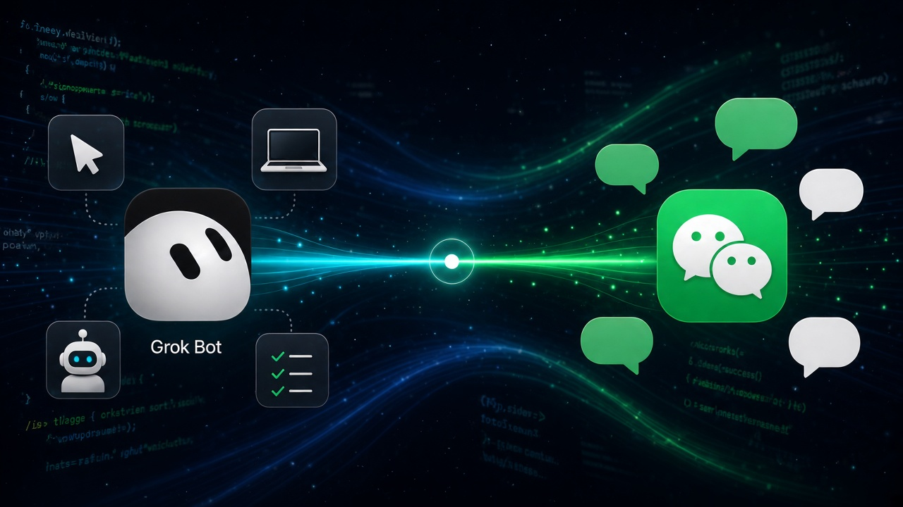
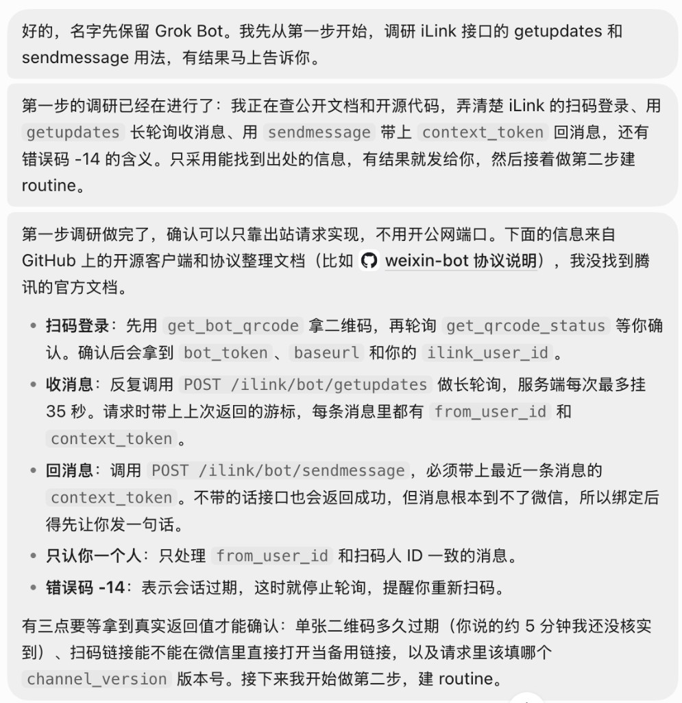
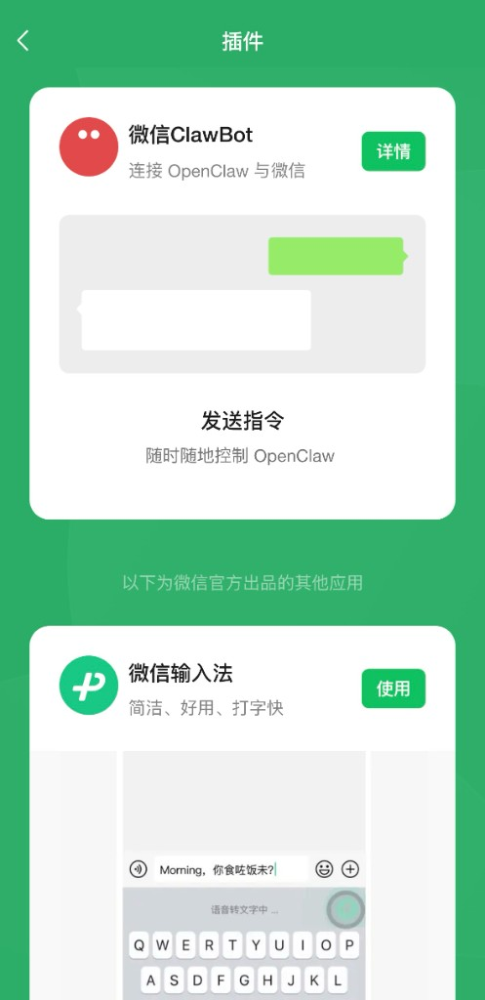
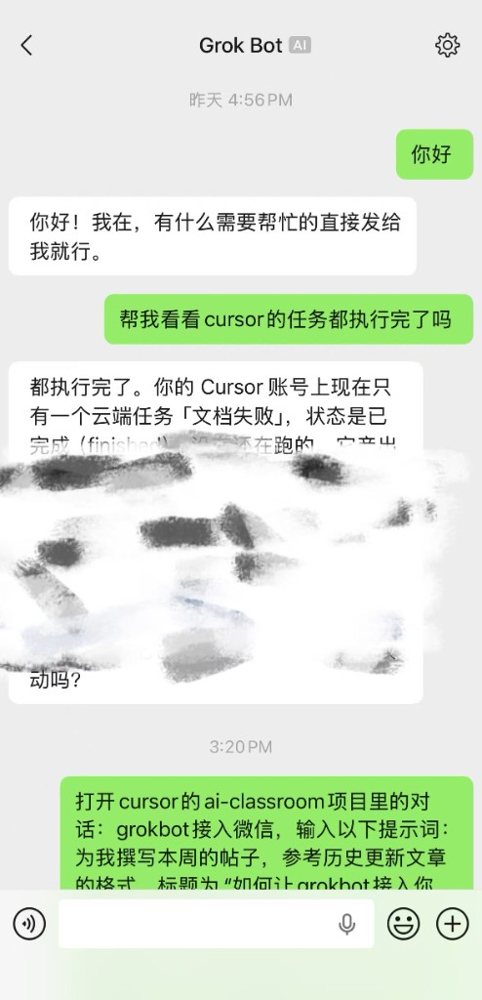

# 把 Grok Bot 接入微信

亲手要做的只有三件事：把接入提示词发给主 Bot、把 Webhook 地址和密钥填进加密弹窗、用微信扫码并先发一句话。通道程序由 Grok Bot 在它的云电脑上自己搭。

微信侧走官方插件「微信 ClawBot」的 iLink 接口（`ilinkai.weixin.qq.com`）。转发程序只发出站请求，不需要在公网上开端口。

## 开始之前

- 电脑上已登录 Grok Bot，并且能打开你的主 Bot 对话。
- 手机微信版本：iOS 8.0.70 及以上，Android 8.0.69 及以上。
- 同一个微信号不要同时再接别的 OpenClaw，否则消息会被拆走。

## 这条链路怎么走

1. 微信 ClawBot 收到你的消息。
2. 云电脑上的转发程序用 `getupdates` 长轮询把消息取走，POST 到主 Bot 里名为「微信下旨入口」的 webhook routine。
3. 主 Bot 处理完后，用这条消息自带的 `context_token` 调用 `sendmessage` 回微信，并在主聊天里留一份。

`context_token` 不能事先编造，必须等你在 ClawBot 对话里发出第一条消息之后才会有。

## 第一步：把接入提示词发给主 Bot

打开电脑端 Grok Bot，进入主 Bot 对话，整段发送：

```text
我想把你接到我的微信上，让我能在微信里直接给你发消息、收到你的回复。请按下面的顺序做，每做完一步告诉我结果，需要我操作的地方停下来等我。

1. 先核对方案：腾讯「微信 ClawBot」插件使用 iLink 接口（ilinkai.weixin.qq.com）。确认如何用 getupdates 长轮询收消息、如何用 sendmessage 回消息。程序只发出站请求，不要开公网端口。
2. 在当前主 Bot 里建一个由 webhook 触发的 routine，名称用「微信下旨入口」。建好后告诉我去 routine 面板复制 Webhook URL 和 key，然后发给我要去复制的网页和加密弹框让我填入web URL和key，不要让我在聊天里发明文。
3. 在你的云电脑上写一个转发程序：收到微信消息后 POST 给这个 routine；处理完成后用 reply 脚本把回复发回微信，并在主聊天里同步一份。启动时恢复消息游标，避免同一条消息执行两次。
4. 等我在手机微信里启用 ClawBot 之后，再生成二维码让我扫码确认，同时给一个可以在微信里直接打开的备用链接。二维码大约 5 分钟有效。凭证和登录图只在私密入口展示。
5. 绑定成功后，提醒我先在 ClawBot 对话里发一句话。回复必须使用这条消息携带的 context_token，不要凭空生成。
6. 只处理已绑定的这一个用户，其他人的消息忽略。回复用纯文本，不要用 Markdown，微信不会渲染。
7. 最后说明：云电脑重启后如何重新拉起转发程序；如果出现错误码 -14（凭证过期），提醒我重新扫码。
```

发完后等它调研并动手。它停下来向你要凭证时，再做第二步。



## 第二步：填入 Webhook 地址和密钥

1. 点开头像，打开右侧详情里的 routine 面板。
2. 找到「微信下旨入口」，复制它的 Webhook URL 和 key。URL 是入口地址，key 是凭证。
3. 在 Grok Bot 弹出的加密弹框里分别粘贴，提交。

界面出现「已安全保存并保持私密」即可。不要把 URL 和 key 贴回聊天记录。

## 第三步：启用插件、扫码、发第一句话

1. 手机微信打开「我 → 设置 → 插件」，找到红色龙虾图标的「微信 ClawBot」，启用它。插件列表里没有这一项时，先停在这里：版本够了也不代表当前账号已经开放入口。

   

2. 回到 Grok Bot，发送「插件开好了」。它会给出二维码，以及一个可在微信内打开的备用链接。二维码大约 5 分钟有效，拿到就扫。
3. 用微信「扫一扫」确认绑定。扫不了就打开备用链接。
4. 打开 ClawBot 对话，先发任意一句话。没有这第一句，回复没有 `context_token`，后面的消息也回不来。

成功的标志有两个：ClawBot 对话里出现回复，主 Bot 聊天里同步了同一段对话。



## 断了以后怎么处理


| 现象             | 处理                       |
| -------------- | ------------------------ |
| 二维码没反应，或提示登录过期 | 让 Grok Bot 重新生成二维码再扫     |
| 错误码 `-14`      | 凭证过期，重新扫码绑定              |
| 云电脑重启后微信没人回    | 让 Grok Bot 把转发程序重新拉起来    |
| 消息被拆到别处        | 确认这个微信号没有同时接另一个 OpenClaw |


