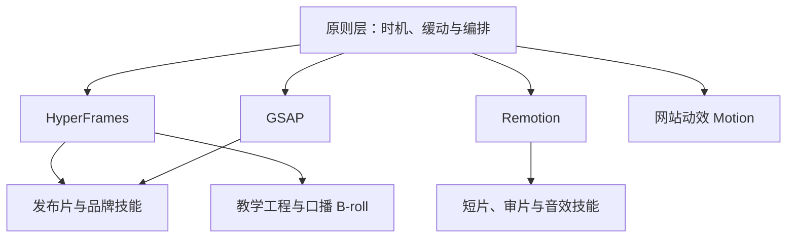

# 用代码拍视频：Claude Opus 5.5 动效工作流与工具选型

Claude Opus 5.5 做视频，走的是写代码、逐帧绘制、再编码成 MP4。下面把一条工具地图、13 个公开作品，以及四份案例与提示词仓库收成同一套做法：先定任务和渲染引擎，再装一套技能，用事实清单、节拍表和抽帧自检把成片稳住。

资料核对于 2026-10-12。来源包括 [Mnimiy 整理的 15 个仓库](https://x.com/mnilax/status/2109314840057565345)、[向阳乔木的提示词库](https://github.com/joeseesun/opus-video-prompts)、[opusvideo 案例片库](https://github.com/opusvideo/awesome-claude-video)、[athemeroy 的来源研究库](https://github.com/athemeroy/awesome-claude-5-5-videos)、[yihui 的提示词墙](https://github.com/yihui-dev/awesome-opus5-5-videos)，以及知乎专栏 [《Opus 5.5 视频示例》](https://zhuanlan.zhihu.com/p/2089785598345326890)。知乎页采集时跳到登录验证；文中关于 475 支公开影片的比例和 13 个例子的结构，核对自 2026-10-03 同题公开文本，每条例子都链回创作者原帖。

## 1. 代码在画每一帧

Opus 5.5 本身不输出视频文件。常见路径是写出 HTML、Canvas、p5.js、GSAP、Three.js、Remotion 或 Manim，用无头浏览器按时间截取每一帧，再用 FFmpeg 合成 MP4。配乐多用 Web Audio 或 Python 合成，旁白另接 TTS。

这条路径适合动态图形、线稿与手绘、科普讲解、产品发布片和歌词式 MV。需要写实人物或实景时，画面交给 Seedance、Runway、Higgsfield 这类视频模型，Opus 负责分镜、挑选和剪辑，并在成片说明里写清谁生成了像素。

知乎文给出的公开样本口径是：约 475 支影片里，大约六成是动态图形，大约五分之四是 16:9，时长中位数约 30 秒；技术上 Canvas 出现最多，其后是 SVG 和 Three.js。好看的成片通常同时具备四件事：节奏有快有停、文字有主次、镜头之间用同一个形状接上、结尾停在片尾卡或一个干净的循环点。缺少方向时，模型容易交回渐变底上的居中淡入字。

本地至少准备三样东西：Node.js 20 或以上、一套 Chromium，以及 FFmpeg。渲染脚本随仓库放一份 GSAP，避免导出时临时去 CDN 拉库。

## 2. 一条可复用的出片流水线

高质量案例几乎都把「先看分镜，再写代码」写成硬步骤。后面改片时只动一个镜头，也方便把人类意见和模型自己的返工分开记账。

各步要交出来的东西：

1. **事实与素材。** 产品名、一句承诺、允许上屏的数字、截图、logo、字体、可商用音乐。名字、日期和功能都来自你批准的清单。
2. **分镜与节拍表。** 总时长、画幅、每个镜头的起止、一句画面、一句字幕。确认后再写绘制代码。
3. **低清样片。** 先渲前几秒，或每个镜头的中帧。草稿可以降分辨率、先关动态模糊。
4. **由时间决定的每一帧。** 画面是 `seek(t)` 的纯函数：同一时刻永远画出同一帧。并行截帧时，CSS transition、计时器和帧间残留状态会闪。弹簧用时间的闭式解，拖拽在按住期间跟指针，松开后再回到目标。
5. **抽帧自检。** 看文字是否出框、是否重叠、事实是否写错、循环的首尾帧是否连位置带速度都对齐。审片材料是接触表：每个节拍一张带时间戳的静帧。
6. **成片与响度。** 需要动态模糊时，每帧抽 2 到 4 张子帧，用 FFmpeg `tmix` 混合，硬切两边不要混到一起。公开模板里，母带常收到约 −14 LUFS。

抽帧自检看的就是这样一张接触表：每个节拍一格，格子上写着时间。模型不用看完整段视频，也能发现重叠、出框和空拍。

*图：claude-motion 示例片的审片接触表。来自 [whaleyxbt/claude-motion](https://github.com/whaleyxbt/claude-motion) 的 `media/sheet.png`，仓库为 MIT。*

[claude-motion](https://github.com/whaleyxbt/claude-motion) 把同一条线写成 `timeline.json`：场景、音效和审片读同一组时间点，改一处节奏，声音和检查点一起动。它给 Opus 5.5 的力度建议也可以直接拿来用：分镜来回用低力度，搭场景用中等力度，逐帧精修用高力度，整片无人值守再用最高力度。同一支示例片里，力度滑杆本身就是画面：

*图：同一示例片中的一帧，界面跟着旁白改配置。来自该仓库的 `media/preview.gif`。*

## 3. 十五个仓库：先定引擎，再装一套

[那条推文](https://x.com/mnilax/status/2109314840057565345) 把 15 个仓库分成发布片、剪已有素材、动画短片、网站动效和官方积木。读完 README，装机顺序是：原则和引擎先就位，出片技能只留一套对口的。

| 仓库 | 层 | 它实际负责 | 入口 |
| --- | --- | --- | --- |
| [heygen-com/hyperframes](https://github.com/heygen-com/hyperframes) | 引擎 | 把 HTML 收成可定位时间轴的视频，带检查和渲染 | `npx skills add heygen-com/hyperframes`，核心集用 `npx hyperframes skills update` |
| [remotion-dev/remotion](https://github.com/remotion-dev/remotion) | 引擎 | 用 React 写可编辑成片 | 按 [官方文档](https://www.remotion.dev/docs/) 初始化项目 |
| [remotion-dev/skills](https://github.com/remotion-dev/skills) | 引擎 | Remotion 的官方写法：构图、字幕、地图等 | `npx skills add remotion-dev/skills` |
| [greensock/gsap-skills](https://github.com/greensock/gsap-skills) | 引擎 | 时间轴、ScrollTrigger、插件和性能 | `npx skills add greensock/gsap-skills` |
| [LottieFiles/motion-design-skill](https://github.com/LottieFiles/motion-design-skill) | 原则 | 把迪士尼十二原则改成与实现无关的动效判断 | `npx skills add LottieFiles/motion-design-skill` |
| [AbubakrChan/product-launch-motion](https://github.com/AbubakrChan/product-launch-motion) | 发布片 | 脚本、旁白锁词、镜头、胶片感和响度母带；默认 HyperFrames，并给出 Remotion 对照 | `npx skills add AbubakrChan/product-launch-motion` |
| [charlie947/motion-graphics-skills](https://github.com/charlie947/motion-graphics-skills) | 发布片 | 15 个技能：品牌录入、发布片、苹果式开场、讲解、图表、循环封面、竖屏导出 | `npx skills add charlie947/motion-graphics-skills` |
| [howseen-ai/claude-motion-design](https://github.com/howseen-ai/claude-motion-design) | 发布片 | 纯 HTML，Playwright 截帧，FFmpeg 编码；先静帧，再全片，再对节拍 | 复制 `skill/motion-design` 到技能目录 |
| [cth9191/animate](https://github.com/cth9191/animate) | 短片 | 剪纸、排线、孔版、素描、数学、像素、等轴测七种画风；分镜确认后才动画 | Claude Code：`/plugin marketplace add cth9191/animate` |
| [whaleyxbt/claude-motion](https://github.com/whaleyxbt/claude-motion) | 短片 | 带数字的缓动规则、按节拍出接触表、Python 音效引擎；仿真页也可逐帧导出 | 克隆后 `npm install && npm run build` |
| [haidrrrry/claude-remotion-skill](https://github.com/haidrrrry/claude-remotion-skill) | 短片 | 在 Remotion 上补弹簧、错峰、字幕、颗粒和出帧检查 | 复制 `remotion-motion-graphics` 到技能目录 |
| [nateherkai/hyperframes-student-kit](https://github.com/nateherkai/hyperframes-student-kit) | 已有素材 | 十余个 HTML + GSAP 成品工程，以及做片、字幕、把网页收成视频的斜杠命令 | 克隆仓库，跟着工程读 |
| [Barty-Bart/motion-graphics](https://github.com/Barty-Bart/motion-graphics) | 已有素材 | 按口播时间轴生成动态图形 B-roll；用 SAM 2 把人或产品从画面里分开 | `npx skills add Barty-Bart/motion-graphics` |
| [motiondivision/motion](https://github.com/motiondivision/motion) | 网站 | 按钮、卡片和页面过渡，面向 React、Vue 和原生 JS | 安装 npm 包 `motion` |
| [199-biotechnologies/motion-dev-animations-skill](https://github.com/199-biotechnologies/motion-dev-animations-skill) | 网站 | 用一句话给现有站点加弹簧、滚动和手势，并检查降级动效 | 克隆到 `.claude/skills` |

Remotion 对个人和小团队免费，超过其公开门槛的公司需要 [商业许可](https://www.remotion.dev/license)。HyperFrames 交互安装时选择 Core Skills，由核心路由在进入具体流程时再安装对应技能。

### 这些仓库画出来的画面

下面几帧都来自仓库自带的示例，许可为 MIT。页首封面是其中的发布片静帧。

*图：产品发布片的一帧，词级渐变和光标都由代码画出。来自 [AbubakrChan/product-launch-motion](https://github.com/AbubakrChan/product-launch-motion) 的 `examples/still-1.jpg`。*

*图：里程碑数字由粒子收成。来自 [charlie947/motion-graphics-skills](https://github.com/charlie947/motion-graphics-skills) 的 `assets/readme/demo-milestone.gif`。*

*图：Remotion 技能包的片头静帧，弹簧和错峰写在时间轴上。来自 [haidrrrry/claude-remotion-skill](https://github.com/haidrrrry/claude-remotion-skill) 的 `demo.gif`。*

### 三条可以照着做的工作流

**产品发布片。** 先跑 charlie947 的 `brand-intake`，写出 `brand.md` 和 `MOTION.md`。然后给产品名、一句承诺、三到五项真实功能、界面截图、一个强调色，以及一首可商用、有明确重拍的音乐。要求先交节拍表和每个镜头的静帧。渲染用 HyperFrames，运动用 GSAP，母带用 FFmpeg。若旁白要和单词对齐，用 [product-launch-motion](https://github.com/AbubakrChan/product-launch-motion)：它把词级时间、双节点镜头和响度检查写成与渲染器无关的规则。

**风格化讲解短片。** 用 [animate](https://github.com/cth9191/animate) 时，顺序是固定的：选定画风，核对事实后的节拍表，确认两三张全尺寸静帧，再确认分镜，最后才渲染。它的检查项包括切点是否落在节拍、主角是否锚住、旁白语速，以及静音之后最响的那一下是否落在重点上。数学讲解也可以改走 Manim，旁白用已配置的 TTS，字幕和画面共用一条时间轴。

同一套故事语法可以换成完全不同的画材。下面三帧来自该仓库的示例，分别是剪纸、孔版和等轴测：

*图：剪纸。`styles/cut-paper/sample.png`。*

*图：孔版。`styles/riso/sample.png`。*

*图：等轴测。`styles/isometric/sample.png`。三帧均来自 [cth9191/animate](https://github.com/cth9191/animate)，MIT。*

七种内置画风放在一起时是这样：

*图：剪纸、排线、孔版、素描、数学、像素、等轴测，以及一格自定义参考。来自该仓库的 `docs/styles.png`。*

**已有口播。** 先写明保持不变的东西：原声、字幕、时长、信息顺序。主画面换成跟着句子走的线稿或动态图形，人像缩到角落。Axton 的公开做法是按字幕切镜头，样片先对十秒，再铺全片，并在说明里保留原片的贡献（[原帖](https://x.com/AxtonLiu/status/2102827887732932956)）。若要自动铺 B-roll 或把主体从背景里分开，用 Barty-Bart 的 `motion-broll`，输入优先用带时间码的 SRT 或 VTT。学生工具包用来看一条 HTML 管线如何从预览走到 MP4。

网站上的按钮、滚动和手势留在 Motion 或页面内的 GSAP。

## 4. 十三个公开作品留下的四条做法

知乎文挑了 13 支真实影片。共同结论可以收成四条。Rexan Wong 的说法概括了前两条：大家用的是同一个模型，专业感来自你给的上下文（[原帖](https://x.com/rexan_wong/status/2103707054108299437)）。

### 一句话用来试能力，品牌片自备事实

Stephan Livera 的 15 秒作品集只有一句：做出一支动态的动态图形，像简历上的 showreel，尽力发挥（[原帖](https://x.com/stephanlivera/status/2103315922098470926)）。同题文章统计，至少约 90 支公开影片用了这句或很近的变体。它适合看模型今天能画出什么。品牌片改成你的产品名、色值和截图。

Deedy 用一句「给一家做推理的现代创业公司做一支利落的发布片」，大约 1 分钟、约 2 美元得到成片（[原帖](https://x.com/deedydas/status/2102787937482252537)）。公司名、等待时间和 GPU 利用率都是模型编的。真发布片要自己写下产品名、三个功能和允许出现的数字；Moritz Kremb 则要求去取真实产品素材，成片才落到具体界面上（[原帖](https://x.com/moritzkremb/status/2103066071838466494)）。

### 先交节拍和静帧，并写一份禁用清单

zero 的 UI 变形把一个形状走完按钮、播放器、图表和命令面板，120 BPM、七小节、每一拍都有动作，最后一帧回到第一帧（[原帖](https://x.com/twoclipping/status/2103273003555402193)）。另一支一镜到底的冲印应用发布片要求：任何代码之前先给出节拍图和四张静帧，并禁止交叉淡化、粒子、辉光和超过一秒的停顿（[原帖](https://x.com/twoclipping/status/2103835273813496100)）。

禁用清单比堆形容词更快去掉模板感。公开模板里反复出现的条目是：粒子爆发、RGB 分离、镜头光晕、霓虹辉光、文字上的渐变、弹跳缓动。charlie947 的技能还额外避开打字机出字和紫蓝渐变底。

### 点名一种媒介或一部参考片

折纸、沙画、或「Grand Budapest Hotel 式」这种短指名，会同时带上调色、剪影和构图。songkeys 用折纸涂鸦讲人类故事，并要求几乎不用口语，故事靠画面走（[原帖](https://x.com/songkeys/status/2102743212922384673)）。Michael Guo 用「沙画」换来颗粒和剪影（[原帖](https://x.com/Michaelzsguo/status/2102592355165782312)）。Ole Lehmann 用四个词点名韦斯·安德森的电影，得到对称构图和粉彩（[原帖](https://x.com/itsolelehmann/status/2103124033365762215)）。

参考片只借用造型和节奏。产品名、文案和音乐用你自己的。

### 把时长和节奏写死

13 条提示里有 6 条锁定了时长或节奏，其中包含点赞最高的作品集和 UI 变形。475 支影片里，一半落在 15 到 43 秒。klöss 那句没有时长的 AI 史，做出了将近三分钟（[原帖](https://x.com/kloss_xyz/status/2103652674336067876)）。需要控制成片时，写上秒数、帧率、BPM，以及「每一拍发生一件事」。

| 作品 | 作者 | 带走的一点 | 原帖 |
| --- | --- | --- | --- |
| 15 秒作品集 | Stephan Livera | 只给目标、时长和完成度，适合试模型 | [链接](https://x.com/stephanlivera/status/2103315922098470926) |
| 推理创业发布片 | Deedy | 约 1 分钟、约 2 美元；事实需自备 | [链接](https://x.com/deedydas/status/2102787937482252537) |
| 真实素材的 SaaS 片 | Moritz Kremb | 界面和 logo 来自真实产品 | [链接](https://x.com/moritzkremb/status/2103066071838466494) |
| 一镜到底的冲印应用 | zero | 禁用清单，先交节拍图和静帧 | [链接](https://x.com/twoclipping/status/2103835273813496100) |
| 一个形状走完九种 UI | zero | 节拍网格，首尾帧构成循环 | [链接](https://x.com/twoclipping/status/2103273003555402193) |
| 金融科技竖屏广告 | David Marcus | 一屏一个想法，静音也能读完 | [链接](https://x.com/davidmarcus/status/2103275618045686217) |
| 20 秒识别片头 | TechHalla | 精确时长、循环、有限色码 | [链接](https://x.com/techhalla/status/2103411244468498547) |
| Negroni 配方 | Rory Flynn | 步骤进度让观众知道走到哪 | [链接](https://x.com/Ror_Fly/status/2102853258582880547) |
| 递归讲解 | Ethan Mollick | 结构本身表达主题 | [链接](https://x.com/emollick/status/2103688362960019567) |
| AI 史上的关键时刻 | klöss | 未锁时长会变长；日期要核对 | [链接](https://x.com/kloss_xyz/status/2103652674336067876) |
| 折纸人类故事 | songkeys | 点名媒介，把叙事交给画面 | [链接](https://x.com/songkeys/status/2102743212922384673) |
| 沙画美国史 | Michael Guo | 一种材质名换来整套质感 | [链接](https://x.com/Michaelzsguo/status/2102592355165782312) |
| 火车窗外的四季 | Ole Lehmann | 点名参考片换来构图和调色 | [链接](https://x.com/itsolelehmann/status/2103124033365762215) |

投入差一个数量级。快的是 Deedy 的约 2 美元；慢的包括 Leon Lin 用代码写完整配乐的发布片，约 8 小时（[原帖](https://x.com/LexnLin/status/2104148233106723099)）。中间还有约 15 分钟的宣传片、改两轮共约 19 分钟，以及三轮提示才定稿的例子。预算按多轮来估。

## 5. 提示词库、片库、研究库和提示词墙各取什么

### 提示词库：四条技术路线，一种模板骨架

[joeseesun/opus-video-prompts](https://github.com/joeseesun/opus-video-prompts) 收的是作者本人公开的提示词，并按实现分成九条路线。做选型时收成四类即可：

| 路线 | 工具 | 代表 |
| --- | --- | --- |
| 单文件逐帧 | Canvas、p5.js、Python 线稿，无头浏览器加 FFmpeg | 像素动画、配方图解、口播改线稿 |
| 成片框架 | Remotion 或 HyperFrames | App 宣传片、产品发布片 |
| 讲解与三维 | Manim、Three.js、Blender | 论文讲解、历史战役、程序化镜头 |
| 模型像素加剪辑 | Seedance、Runway，以及对已有素材的剪辑 | 写实镜头、多条素材合成发布片 |

专业模板可以收成同一张骨架，不必复制几千字原文：

- **先问输入。** 状态列表、强调色、可商用音乐、真实素材，齐了再写代码。
- **方向。** 一个镜头一个想法，一种镜头语言，一种字体。
- **禁用项。** 见上一节的清单。
- **结构。** 按小节或 BPM 排事件，切点落在重拍。
- **实现。** `seek(t)`；歌曲用节拍检测对齐；音效的峰值对准事件，文件起点对准会晚一拍。
- **交付前。** 每个重拍抽一帧，修拥挤、重叠和看不清的字。

密钥放 `.env`。在 Claude 的设置里拒绝读取该文件，并把 TTS 的接口说明放进项目里的独立文档。换题目时复用同一条讲解提示，事实清单跟着换。

### 片库：按任务找原帖

[awesome-claude-video](https://github.com/opusvideo/awesome-claude-video) 按产品、动态图形、讲解、叙事、三维、MV 与剪辑分类，每条给出原帖、简短做法，以及作者公开提示词时的实现说明。用它找跟这次任务最接近的一支，再回到原帖看条件。成片在原帖播放，版权归创作者。

找片时顺手记下输入边界。例如口播改线稿保持了原声和时长；奥斯特里茨战役附了油画参考，并开源了 WebGL、旁白和渲染流程（[仓库](https://github.com/WinterArc21/Battle-of-Austerlitz-Film)）；有的 MV 是角色图加视频模型底片，再由代码逐帧重绘。对照效果时，只把输入条件相同的片子放在一起。

### 研究库：选风格、记成本、分开披露

[athemeroy/awesome-claude-5-5-videos](https://github.com/athemeroy/awesome-claude-5-5-videos) 截至 2026-10-11 收了 424 条来源帖，其中 199 条做了九帧抽样。模型标签大致是 Opus 301、Sonnet 54、Haiku 21、创作者报告的 Fable 68。一条帖可以跨模型，相加会把同一条帖计多次。这些数字用来看收录覆盖，同一提示下的模型比较要另做对照实验。

内容与配色研究用的是另一套分母：2026-09-26 的 1119 个文件。游戏与交互里，约 70% 标成 3D（161/230）；广告与发布片里，约 71.6% 标成动态图形或 UI（154/215）。讲解和故事更散，最大的一类也只占三成多，选做法时要多看几支同类。

*图：领域与风格热力图。来自 [athemeroy/awesome-claude-5-5-videos](https://github.com/athemeroy/awesome-claude-5-5-videos)，图表以 CC BY 4.0 发布。深色格是数量更高的组合。*

同一类里，深色和浅色会同时大量存在。350 个动态图形或 UI 文件分成 198 个深色中性和 152 个浅色中性，取一条「平均配色」会把两种设计选择抹平。音乐视频的彩色像素占比中位数约 45.5%，广告约 17.6%。用这组数字找视觉参考。图里的互动数据来自另一批帖子，和配色统计分开阅读。

研究库把制作发现收成三句，可以直接写进自己的项目记录：

| 发现 | 带到项目里 |
| --- | --- |
| 很短的请求可以带着很重的输入 | 素材、音频和交付标准一次给齐 |
| 一轮人类提示会触发多轮内部返工 | 人类提示和模型自检分开记 |
| 整单成本才可比 | 把返工、工具和外部素材算进去；模型比较限定在同一任务、同一输入 |

它还重写了七类实验模板（[中文说明](https://github.com/athemeroy/awesome-claude-5-5-videos/blob/main/docs/prompt-playbook.zh-CN.md)）。用的时候记住每类要锁住的边界：

| 任务 | 提示里写清 |
| --- | --- |
| 零外部画面的代码动画 | 时长、画幅、禁止外部图片；先 6 到 8 个镜头；先渲前 5 秒 |
| 教育讲解 | 来源和学习目标；未核对的公式标成待确认；模型若不能试听，旁白标成待人工听审 |
| 用现有产品做宣传 | 只用有权使用的截图和文案；不编造功能、用户数据和评价 |
| 三维镜头 | 先灰模和相机；写明哪些资产是程序生成的 |
| 视频模型出像素 | 写明 Opus 做策划，命名的视频模型出画面，以及生成次数 |
| 改编已有影片 | 列出必须保持的原声、字幕、时长和信息顺序 |
| 已有技能的短触发词 | 同时写明预置技能、已有录音和外部服务，避免把一句触发词说成全程说明 |

公开说明分成四栏，各写各的：「一句提示」记录人类开口的轮数，「纯代码」记录画面怎么画出来，「零外部素材」记录输入边界，「无人修改」记录审片过程。

### 提示词墙：复制提示，并看对照重制

[yihui-dev/awesome-opus5-5-videos](https://github.com/yihui-dev/awesome-opus5-5-videos)（MIT，核对于 2026-10-12）把创作者公开的提示词收成单文件，并在 [Skillry](https://skillry.dev/ai-videos/opus-5-5) 上把原片和现场重制并排播放。前面几节用来选路线；要换题目试同一条提示，从这里复制。

当天的收录是：`prompts/` 和 `data/videos.json` 里 853 条提示，其中 523 条有现场重制。README 另精选 100 条互不重复的提示，分成动态图形 58、讲解 16、三维场景 14、游戏与交互 12。同一天又补了 10 支片（多为讲解和三维）以及 330 条提示，下面表里是其中最新的 30 条。

精选墙里，动态图形超过一半，技术标注反复出现 Canvas、SVG 和 GSAP。三维和游戏更常标 Three.js、GLSL；可玩的条目还会标 Playable、像素或物理。作品和提示词仍归创作者，预览短片由该列表托管。

上文已经写过的片子，在这面墙上有对应文件：

| 上文作品 | 提示词文件 |
| --- | --- |
| 推理创业发布片 | [deedydas](https://github.com/yihui-dev/awesome-opus5-5-videos/blob/main/prompts/deedydas-252537.md) |
| 真实素材的 SaaS 片 | [moritzkremb](https://github.com/yihui-dev/awesome-opus5-5-videos/blob/main/prompts/moritzkremb-466494.md) |
| 一镜到底的冲印应用 | [twoclipping](https://github.com/yihui-dev/awesome-opus5-5-videos/blob/main/prompts/twoclipping-496100.md) |
| Negroni 配方 | [ror-fly](https://github.com/yihui-dev/awesome-opus5-5-videos/blob/main/prompts/ror-fly-880547.md) |
| 递归讲解 | [emollick](https://github.com/yihui-dev/awesome-opus5-5-videos/blob/main/prompts/emollick-019567.md) |
| AI 史上的关键时刻 | [kloss-xyz](https://github.com/yihui-dev/awesome-opus5-5-videos/blob/main/prompts/kloss-xyz-067876.md) |
| 折纸人类故事 | [songkeys](https://github.com/yihui-dev/awesome-opus5-5-videos/blob/main/prompts/songkeys-384673.md) |
| 沙画美国史 | [michaelzsguo](https://github.com/yihui-dev/awesome-opus5-5-videos/blob/main/prompts/michaelzsguo-782312.md) |
| 火车窗外的四季 | [itsolelehmann](https://github.com/yihui-dev/awesome-opus5-5-videos/blob/main/prompts/itsolelehmann-762215.md) |
| 代码配乐的发布片 | [lexnlin](https://github.com/yihui-dev/awesome-opus5-5-videos/blob/main/prompts/lexnlin-241739.md) |

用法就三步：打开 `prompts/` 里的文件，复制 **Prompt** 代码块，贴给 Opus 5.5，并要求收成单个 HTML。要 MP4 时，再走第二节的逐帧渲染。有的作者只公开了一部分提示，或只在帖子里描述了结果，这些文件会写明。

两条当天新增的记录，和前面的流水线是同一件事的更硬版本：

- [@0xKarmi](https://x.com/0xKarmi/status/2108495927988129839) 的文件把制作拆成固定画布、无窗口引擎对帧号调用一次 `draw(f)`、FFmpeg 编码，以及构建后的三轮检查。接缝检查把第 0 帧和第 720 帧逐像素对比，差一个像素就说明运动没有周期性。人看片之前先过六项是非门。文件记下一次渲染：1820 帧，六项计数都是零（[提示词文件](https://github.com/yihui-dev/awesome-opus5-5-videos/blob/main/prompts/0xkarmi-129839.md)）。
- [@fleyta88](https://x.com/fleyta88/status/2108249741125443662) 把 GSAP 时间轴的时长写死：卡片 280ms、标题 220ms、元数据 160ms、元素错峰 60ms。再用 Playwright 逐帧截图，发现过冲就打补丁，不整段重写（[提示词文件](https://github.com/yihui-dev/awesome-opus5-5-videos/blob/main/prompts/fleyta88-443662.md)）。

| 最新提示 | 作者 | 文件 |
| --- | --- | --- |
| [动态图形音乐机](https://x.com/adrianduta96/status/2109187815195992248) | @adrianduta96 | [提示词](https://github.com/yihui-dev/awesome-opus5-5-videos/blob/main/prompts/adrianduta96-992248.md) |
| [喀拉喀托火山 WebGL](https://x.com/pagustafsson/status/2108936279081566609) | @pagustafsson | [提示词](https://github.com/yihui-dev/awesome-opus5-5-videos/blob/main/prompts/pagustafsson-566609.md) |
| [云上城堡](https://x.com/YouWareAI/status/2108825933608300653) | @YouWareAI | [提示词](https://github.com/yihui-dev/awesome-opus5-5-videos/blob/main/prompts/youwareai-300653.md) |
| [三维标志片头](https://x.com/juancarlos17626/status/2108663865936429530) | @juancarlos17626 | [提示词](https://github.com/yihui-dev/awesome-opus5-5-videos/blob/main/prompts/juancarlos17626-429530.md) |
| [苹果演进动态图形](https://x.com/aiRobertDaily/status/2108596616756416945) | @aiRobertDaily | [提示词](https://github.com/yihui-dev/awesome-opus5-5-videos/blob/main/prompts/airobertdaily-416945.md) |
| [动态图形发布片](https://x.com/softal_io/status/2108574208548614622) | @softal_io | [提示词](https://github.com/yihui-dev/awesome-opus5-5-videos/blob/main/prompts/softal-io-614622.md) |
| [黄金时刻庄园](https://x.com/Thusatharan/status/2108544807333433543) | @Thusatharan | [提示词](https://github.com/yihui-dev/awesome-opus5-5-videos/blob/main/prompts/thusatharan-433543.md) |
| [交互式枯山水](https://x.com/arixxbt/status/2108541814718292438) | @arixxbt | [提示词](https://github.com/yihui-dev/awesome-opus5-5-videos/blob/main/prompts/arixxbt-292438.md) |
| [Opus 5.5 动画故事](https://x.com/N01ennn/status/2108520767092597182) | @N01ennn | [提示词](https://github.com/yihui-dev/awesome-opus5-5-videos/blob/main/prompts/n01ennn-597182.md) |
| [电影感 F1 进站](https://x.com/rubenssoto_ai/status/2108512810774802657) | @rubenssoto_ai | [提示词](https://github.com/yihui-dev/awesome-opus5-5-videos/blob/main/prompts/rubenssoto-ai-802657.md) |
| [程序化三维大象](https://x.com/Thusatharan/status/2108511286795640926) | @Thusatharan | [提示词](https://github.com/yihui-dev/awesome-opus5-5-videos/blob/main/prompts/thusatharan-640926.md) |
| [品牌预告](https://x.com/UtsavChopra30/status/2108510252404560359) | @UtsavChopra30 | [提示词](https://github.com/yihui-dev/awesome-opus5-5-videos/blob/main/prompts/utsavchopra30-560359.md) |
| [由帧号决定的渲染](https://x.com/0xKarmi/status/2108495927988129839) | @0xKarmi | [提示词](https://github.com/yihui-dev/awesome-opus5-5-videos/blob/main/prompts/0xkarmi-129839.md) |
| [天坛三维动画](https://x.com/shunshu32385143/status/2108480534254944719) | @shunshu32385143 | [提示词](https://github.com/yihui-dev/awesome-opus5-5-videos/blob/main/prompts/shunshu32385143-944719.md) |
| [刹车踏板应力模拟](https://x.com/chang_/status/2108458503367200908) | @chang_ | [提示词](https://github.com/yihui-dev/awesome-opus5-5-videos/blob/main/prompts/chang-200908.md) |
| [Rust 逐帧音频响应](https://x.com/BuildFastWithAI/status/2108403445304844291) | @BuildFastWithAI | [提示词](https://github.com/yihui-dev/awesome-opus5-5-videos/blob/main/prompts/buildfastwithai-844291.md) |
| [带旁白的交互演示](https://x.com/Drake5112/status/2108394129000661428) | @Drake5112 | [提示词](https://github.com/yihui-dev/awesome-opus5-5-videos/blob/main/prompts/drake5112-661428.md) |
| [土星五号可交互模型](https://x.com/aichrislee/status/2108347412636938609) | @aichrislee | [提示词](https://github.com/yihui-dev/awesome-opus5-5-videos/blob/main/prompts/aichrislee-938609.md) |
| [SaaS 发布片](https://x.com/Screeendev/status/2108333630623981790) | @Screeendev | [提示词](https://github.com/yihui-dev/awesome-opus5-5-videos/blob/main/prompts/screeendev-981790.md) |
| [熔岩灯 WebGL](https://x.com/juancarlos17626/status/2108301453907382690) | @juancarlos17626 | [提示词](https://github.com/yihui-dev/awesome-opus5-5-videos/blob/main/prompts/juancarlos17626-382690.md) |
| [房屋生长](https://x.com/cryptowluha/status/2108253385829060792) | @cryptowluha | [提示词](https://github.com/yihui-dev/awesome-opus5-5-videos/blob/main/prompts/cryptowluha-060792.md) |
| [带逐帧检查的 GSAP 时间轴](https://x.com/fleyta88/status/2108249741125443662) | @fleyta88 | [提示词](https://github.com/yihui-dev/awesome-opus5-5-videos/blob/main/prompts/fleyta88-443662.md) |
| [UI 运动循环](https://x.com/flxrnc/status/2108242454105251921) | @flxrnc | [提示词](https://github.com/yihui-dev/awesome-opus5-5-videos/blob/main/prompts/flxrnc-251921.md) |
| [Blender 汽车追逐预演](https://x.com/tonysurix/status/2108230699224596746) | @tonysurix | [提示词](https://github.com/yihui-dev/awesome-opus5-5-videos/blob/main/prompts/tonysurix-596746.md) |
| [食欲产品发布片](https://x.com/ultimaxbt/status/2108210884799549714) | @ultimaxbt | [提示词](https://github.com/yihui-dev/awesome-opus5-5-videos/blob/main/prompts/ultimaxbt-549714.md) |
| [Minecraft 街景](https://x.com/0xverdao/status/2108188411844776363) | @0xverdao | [提示词](https://github.com/yihui-dev/awesome-opus5-5-videos/blob/main/prompts/0xverdao-776363.md) |
| [电影感梦境](https://x.com/SimonasLTU1/status/2108175272964981181) | @SimonasLTU1 | [提示词](https://github.com/yihui-dev/awesome-opus5-5-videos/blob/main/prompts/simonasltu1-981181.md) |
| [小组件动效](https://x.com/Khlaseek_dsgner/status/2108167809997877659) | @Khlaseek_dsgner | [提示词](https://github.com/yihui-dev/awesome-opus5-5-videos/blob/main/prompts/khlaseek-dsgner-877659.md) |
| [AI 史动态视频](https://x.com/btcup99/status/2108152460523311469) | @btcup99 | [提示词](https://github.com/yihui-dev/awesome-opus5-5-videos/blob/main/prompts/btcup99-311469.md) |
| [诺贝尔奖科学](https://x.com/KeWai386772/status/2108143449841262769) | @KeWai386772 | [提示词](https://github.com/yihui-dev/awesome-opus5-5-videos/blob/main/prompts/kewai386772-262769.md) |

## 6. 开工检查清单

- 任务已选定，只装了对应的引擎和一套技能。
- 机器上有 Node.js 20+、Chromium 和 FFmpeg。
- 上屏的名字、数字和功能来自已批准清单；logo 和截图来自你的文件。
- 音乐、音效和字体允许你这种用途。
- 时长、画幅、帧率已经写死；需要卡点时写了 BPM。
- 代码开始前已经看过节拍表或静帧。
- 画面由时间决定，正式渲染前看过每个镜头的中帧。
- 循环片的第一帧和最后一帧对齐。
- 旁白若没有人工听过，成片说明里标成待听审。
- API 密钥在 `.env`，代理的读取规则拒绝打开它。
- 成本按多轮估计。公开量级从约 2 美元的短片，到约 200 美元或一周额度约一成的长 MV，中间还有约 25 美元、一个多小时的交互讲解。

三条起步就够：发布片用 HyperFrames、GSAP 和 `brand-intake`；要留下可编辑的 React 工程时用 Remotion 及其官方技能；讲解短片用 animate 的分镜门禁，或 Manim 加 TTS。其余仓库在这三条走顺之后再加。

## 资料

- [Mnimiy：15 个仓库的工具地图](https://x.com/mnilax/status/2109314840057565345)
- [知乎：Opus 5.5 视频示例](https://zhuanlan.zhihu.com/p/2089785598345326890)
- [joeseesun/opus-video-prompts](https://github.com/joeseesun/opus-video-prompts)
- [opusvideo/awesome-claude-video](https://github.com/opusvideo/awesome-claude-video)
- [athemeroy/awesome-claude-5-5-videos](https://github.com/athemeroy/awesome-claude-5-5-videos)
- [yihui-dev/awesome-opus5-5-videos](https://github.com/yihui-dev/awesome-opus5-5-videos)（提示词墙，MIT；对照重制在 [Skillry](https://skillry.dev/ai-videos/opus-5-5)）
- 封面与发布片静帧：[AbubakrChan/product-launch-motion](https://github.com/AbubakrChan/product-launch-motion)，MIT
- 接触表与设置界面帧：[whaleyxbt/claude-motion](https://github.com/whaleyxbt/claude-motion)，MIT
- 里程碑粒子帧：[charlie947/motion-graphics-skills](https://github.com/charlie947/motion-graphics-skills)，MIT
- 片头静帧：[haidrrrry/claude-remotion-skill](https://github.com/haidrrrry/claude-remotion-skill)，MIT
- 画风单帧与总览：[cth9191/animate](https://github.com/cth9191/animate)，MIT
- 热力图来自 athemeroy 仓库，CC BY 4.0
