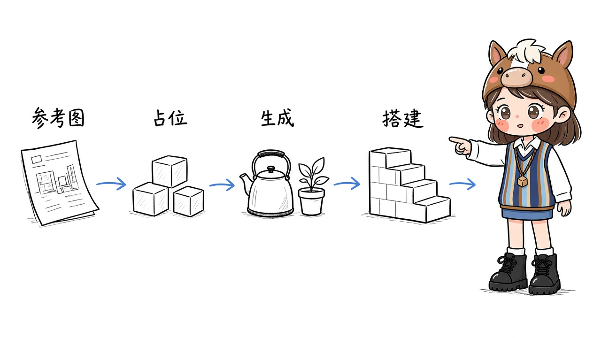
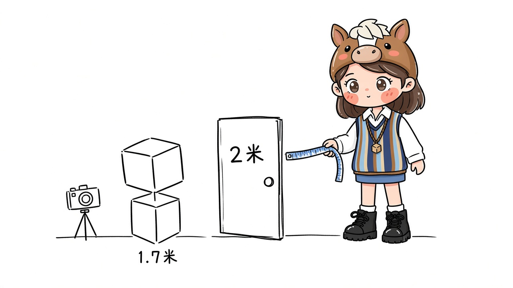
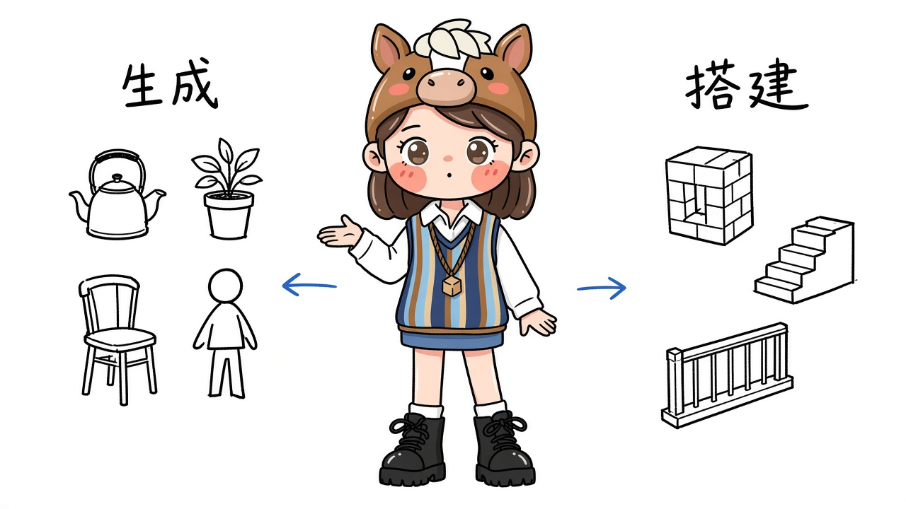
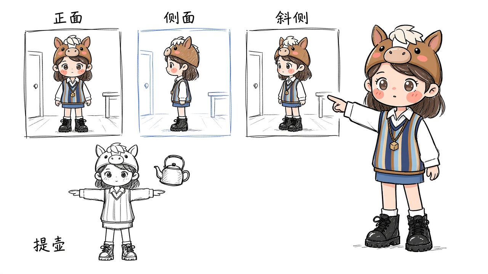

# 用 Opus 5.5 做 3D 模型

Opus 5.5 不负责把网格捏出来。它看参考图，决定哪一件东西要生成、哪一件用方块搭，然后操作 Blender 和 Unity 把它们摆到位，再按截图改。

一条能跑通的顺序是：先写清楚场景里有什么、人物要做什么；用图像模型出参考图；用方块按真实尺寸占住空间；不规则的道具和角色交给 Tripo 生成网格；墙、地面、台阶这类规则几何交给 Blender；导入后先对齐尺寸、应用缩放，再让 Opus 5.5 把两边拼进 Unity；最后单独开一轮，只修对不齐的地方。需求可以用 Fable 这一类模型先理一版。摆模型的对话里不要同时改玩法、光照和加载。

一个任务只做一件事。这一步能看、能走，就用 Git 提交一次。这样坏掉的那次才退得回去。

## 开工前装什么

缺一件，后面的提示词就没有着落：

- **Blender**，并装上 Blender CLI。生成出来的模型在这里减面、改拓扑、对齐尺寸，规则几何也在这里搭。
- **Auto-Rig Pro**（付费插件）。人物要绑骨、蒙皮、做和道具接触的动作时用它。只做静物可以先不装。Tripo 里的 Auto Rig 可以先看关节弯起来塌不塌，塌了就回到网格，不必马上进插件。
- **Unity 6** 或更新版本，再装 Unity CLI，在工程目录里运行 `unity pipeline install`。Pipeline 装进编辑器之后，模型才能通过 Unity CLI 自带的 MCP 改场景，而不是只在聊天里描述场景。更早的编辑器版本接不上这个包。Unity 里 1 个单位是 1 米。
- **Tripo** 账号。要放进引擎、还要绑骨的，用 Smart Mesh P2.0，四边面，面数自己定。H3.1 细节高、面也密，只留给特写主体，并且接受进 Blender 再减面。
- 人物动作再加一个 [Mixamo](https://www.mixamo.com/) 账号，用来下 FBX。

## 参考图先于模型

一张你满意的效果图定画风、配色和主要物体的位置。俯视说明布局，斜侧说明高度和层次。室内外都有的场景，两个角度都要有。用来补全视角的提示词交给图像模型，不交给 Opus：

> 基于上传的场景参考图，帮我生成一张该场景的全面貌参考图片，包括整体环境的多视角视图以及局部细节的展示。

图没定之前，不要让 Opus 开始摆模型。它会把一张含糊的图理解成一套含糊的尺寸。

人物要四张固定角度：正、背、左、右，都是 T-pose。不必四张齐了才生成，正面加背面已经比单张强。各角度的五官、衣服和配色必须是同一个人。

## 先占位，再换模型

参考图定了画风，还没定你走进去之后的尺寸。生成模型之间也没有统一的真实大小，同一个流程出来的身体和配件，导入后常常要分别缩放。

所以先在 Unity 里用方块、平面和一架相机搭灰盒，不生成模型，也不加光照和特效。人高大约 1.7 米，门高大约 2 米，路要能走过去。灰盒能走了再逐个换成正式网格。后加的模型去迁就这个尺寸，不要让场景跟着某一件生成结果一起放大缩小。

## 先拆资产，再生成

参考图交给 Opus，让它标出哪些进 Tripo、哪些留在 Blender：

> 我现在要进行游戏开发，我的技术栈是 Tripo + Blender + Unity。你根据上传的场景参考图，深入分析哪些资产适合用 Tripo 生成，哪些适合用 Blender 直接搭建。将需要 Tripo 生成的资产在图片中标注出来，方便我确认。

这一步你要自己看一遍标注，再去点生成。

适合生成的，是外形不规则、又要单独摆的东西：角色、水壶、一盆具体的植物、一把形状复杂的椅子。适合直接搭的，是尺寸必须准、又会重复出现的东西：墙、台阶、栏杆、桌面、轨道。把一块平地送去生成，得到的是一块没法对齐的网格；把一张脸用方块堆，得到的是另一个人。招牌、价签、告示也可以不进 Tripo。用程序画一张只含文字的贴图，比再生成一张字会写错的图更干净。

进引擎的网格用 P2.0。四边面的面数大约在 500 到 25000 之间，按这个物体在画面里有多大来选，不要一律把精度拉满。多生成几档面数，留布线最干净的那一档。特写才看得到的主体再用 H3.1，进 Blender 减面之后才许进场景。

白模先看，再贴图。把视图切到线框：四肢粘在一起、破洞、姿势不是 T-pose、身体中间还有一套内表面，就重生成或只用 Edit Mesh 改那一块。这种网格硬修，往往比重新生成更慢。形状对了再点纹理。

## 把网格摆进场景

导出之后，连同多视角参考图一起交给 Opus 5.5。进场景之前先在 Blender 里做三件事，否则后面的绑骨和碰撞都会歪：

1. 用门高或身高当尺子，把模型缩到真实尺寸。
2. 应用缩放和旋转，让缩放回到 1、旋转回到 0。没应用的缩放是绑骨之后模型炸开的常见原因。这一步只保证 Blender 里的绑定是干净的。
3. 导出再对一次朝向。Blender 是 Z 轴朝上，Unity 是 Y 轴朝上，应用旋转解决不了这件事。FBX 导出时把向上轴设为 Y。进来之后若整个人变成一百多米，或缩成几厘米，是单位换算，不是参考图错了，按 1.7 米再量一次。脚或底面要落在地面上，不要躺倒，也不要陷进地里。

然后让 Opus 操作 Blender 和 Unity：按图摆放、改比例、补上那些不该生成的结构。

「按参考图完美复刻，发现差异就不断迭代」没有终点，模型会一直改。把完成条件写进提示词：

> 技术栈是 Tripo、Blender CLI 和 Unity。Unity CLI 与 Pipeline 已装好，你可以通过 Unity MCP 改工程。
>
> 附件是场景的正面、侧面、俯视参考图，以及已导出的模型。按参考图搭建：
>
> - 每个导入模型写明它对应参考图里的哪一件、目标高度（米）和摆放位置
> - 墙、地面、台阶、栏杆用方块搭建，不要再送去生成
> - 比例以门高或人物身高为基准。摆完后应用缩放和旋转。导出 FBX 时向上轴设为 Y。进 Unity 后若身高差了约 100 倍，按 1.7 米改导入缩放，不要重做模型
>
> 搭完后从正面、左侧面、45 度各截一张。另开一轮只看截图和参考图的审查，列出对不齐的项：位置、比例、缺件、穿模。改完再截一轮。三个机位都对上，或同一处改了两轮仍对不齐，就停，把剩下的差异列成清单交给我。

你要提供的是截图，不是「看起来差不多」。正面、侧面、斜侧各一张，比一段形容词有用。审查和搭建分开做：搭场景的那一轮已经见过参考图，容易说服自己已经对齐了。先列出问题，再改。不要边看边改边加新东西。

## 人物要能做动作

静物摆完还不是角色。网格确认之后再绑骨，绑骨之后再接动作。

Mixamo 要的是一整块连通的身体、T-pose、接近真实的身高。头发、披风、手里的东西如果和身体焊在一起，一弯手臂就会跟着扯。能拆开的先拆开，或者确认它们不该跟着皮肤变形。

还没绑骨的网格转不了肩膀。先用 Tripo 的 Auto Rig，或 Auto-Rig Pro 的第一次绑定，把肩和肘转一下。变形已经塌了，就换网格，不要先去 Mixamo 下十个动作。

> 使用 Auto-Rig Pro 为人物完成绑骨和蒙皮，确保骨骼位置与人物关节对齐。完成后测试抬手、弯腿、转身等基础动作，检查并修正明显的变形、拉扯和穿模问题。

然后按这个人物真正要用的动作，去 Mixamo 搜关键词，下载 FBX，让 Opus 对到这套骨骼上，而不是对到 Mixamo 的默认人台上就算完。

手里拿着东西的动作，动作库里往往没有正好的一条。选一个接近的，再在 Blender 里改接触。以提水壶为例：

> 请参考提供的 Mixamo 动作，保留其中适用的部分，并使用 Auto-Rig Pro 的手臂 IK 控制器调整手臂姿势，配合手指握持和水壶位置的细节修正，补全提水壶动作。确保手掌与把手接触稳定、提起过程自然，避免穿模、握持脱离或水壶悬空。

检查时看三处就够：指尖有没有进到把手里，把手有没有离开手心，胳膊弯起来时肘部的网格有没有扯成一条线。换一把剑、一个杯子，看的还是这三处。

## 怎样算做完

三个机位都对上，这块模型就可以停。同一处改了两轮仍对不齐，把差异列成清单，换一张参考图或换一个生成结果，不要在同一条对话里继续磨。

每换进一个模型就提交一次。光照、水面、特效和音效是模型都就位之后的下一轮，不要写进摆模型的任务里。模型进了 Unity，只说明场景里有了这个物体。打包、加载、能不能在浏览器里跑，是后面的事。
